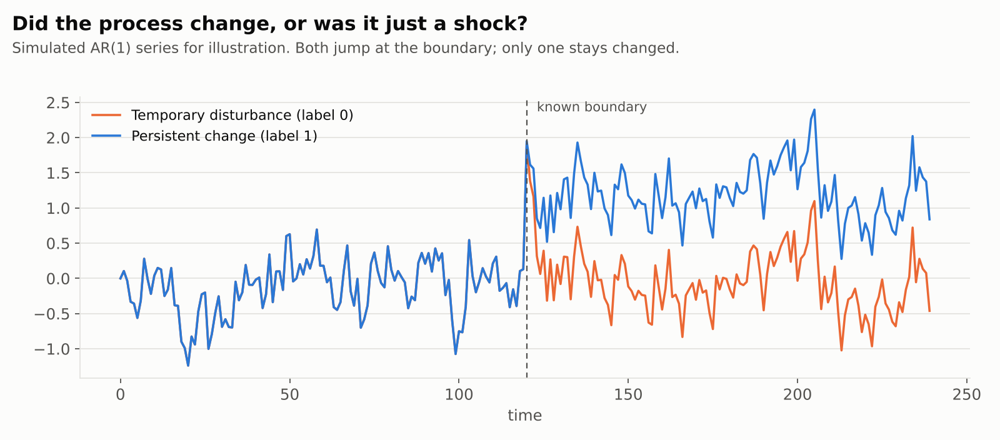
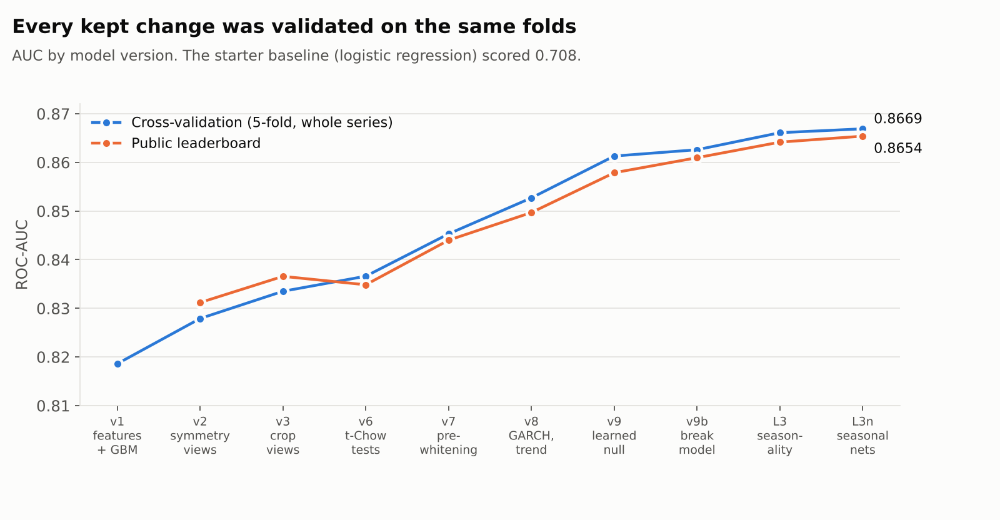
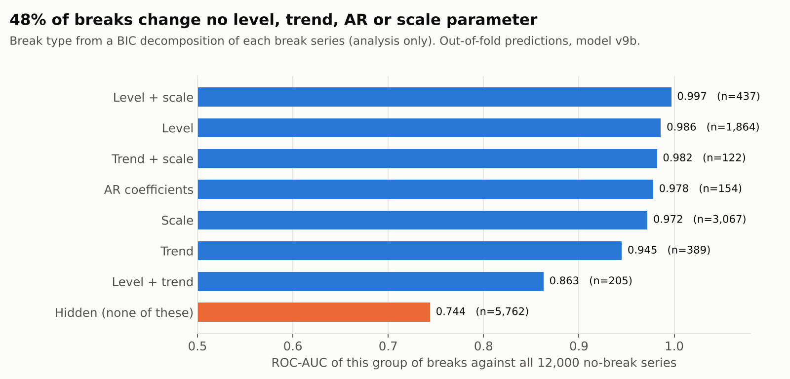

# Detecting persistent structural breaks in time series

Given a univariate time series and a known boundary, did the process that generates the data
change at that boundary, or does it only look different because of noise, outliers or a
temporary shock?

This repository documents the model I built for that question, on the KU-SBB structural break
challenge (KU Applied AI Challenge 2026, hosted on Kaggle). It covers 24,000 labelled synthetic
series and 4,000 test series, scored by ROC-AUC.

| | ROC-AUC |
|---|---|
| Starter baseline (before/after features + logistic regression) | 0.708 |
| **Final model, 5-fold cross-validation (whole series)** | **0.8669** |
| **Final model, public leaderboard** | **0.86539** |

The final model runs on **2 CPU cores, 8 GB of RAM, in under 30 minutes, with no network**, and
two cold runs give identical probabilities.



## What made the difference

1. **Make classical tests valid on dependent data.** Two-sample tests (t, KS, energy distance, MMD)
   assume independent observations. Most series here are autocorrelated, heavy-tailed or
   volatility-clustered, so the tests fire by chance. Running the whole battery on
   **prewhitened innovations** (AR, detrended and GARCH(1,1)-filtered) was the largest single
   jump of the project: 0.8366 → 0.8453.
2. **Learn the no-break process instead of assuming it.** A dilated 1-D CNN encoder plus a
   Student-t mixture density decoder, trained only on boundary-free stretches, predicts the next
   point given the regime. Its likelihood ratios act as a *learned Chow test*. Its predictive CDF
   maps every point to a normal score that is i.i.d. N(0,1) under no break, so the classical
   battery can be rerun on those scores ("Gaussianization").
3. **Learn what real breaks look like.** Fine-tuning that network on break series (H1) and
   no-break series (H0) gives a Neyman–Pearson style likelihood ratio against the breaks that
   actually occur in the data.
4. **Find the failure mode, then target it.** Error analysis showed that about 15% of series
   carry a strong seasonal cycle. A change of phase or amplitude leaves the marginal distribution
   and spectrum unchanged, and the cycle swamps every other test. Seasonal change tests plus the
   full battery on the **deseasonalized** series gave the last big gain (0.8614 → 0.8652 on one
   seed).
5. **Validate first, and keep only what survives.** All of this was done on fixed whole-series
   folds, with every learned component cross-fitted, so gains of 0.001 to 0.002 could be trusted.
   The leaderboard tracked them.



## Pipeline

```
series ──► 12 label-preserving views (orig, sign flip, time reversal, both, 8 random crops)
        │
        ├─► handcrafted change statistics ............ features.py / features_lean.py (numba)
        │     raw, differenced, |deviation|, cumulative sum, prewhitened innovations:
        │     contrasts, two-sample tests, AR / Student-t / trend Chow tests,
        │     AR cross-prediction, CUSUM and split-point scans, persistence tests
        │
        ├─► seasonal change tests + battery on the deseasonalized series ... seasonal.py
        │
        ├─► learned no-break networks (8/32 and 16/64 Student-t mixtures) ... nullnet2.py, nullfast.py
        │     likelihood ratios pre / post / pooled  (a learned Chow test)
        │     normal scores z_t → classical battery and full pipeline on z ... nullgauss*.py
        │
        ├─► learned break models H1 / H0 / hidden-break ........... nullbreak.py, hidden_h1.py
        │     log p(post | pre, H1) − log p(post | pre, H0)
        │
        └─► networks rerun on the deseasonalized series (seasonal series only) ... make_ds_nets.py
                                   │
                    ~5,200 features ▼
              XGBoost, 7 seeds, averaged over views and seeds ............ cv_xgb.py, fit_final_xgb.py
```

Details on every block, and the reasoning behind it, are in
[`docs/methodology.md`](docs/methodology.md).

## Validation

- **5-fold split by whole series**, stratified by label, seed 2026 (`solution/folds.csv`). All 12
  views of a series stay in its fold.
- **Everything learned is fit on training folds only.** The networks are cross-fitted: features of
  a fold-k series come from networks trained without fold k. Early stopping uses a split inside
  the training folds, never the validation fold. Handcrafted and seasonal features have no fitted
  state.
- **Selection discipline.** Whole feature families were kept or dropped, never single features.
  Ideas were screened with a fast GPU XGBoost run and confirmed with more seeds. A fresh fold
  assignment (seed 2027) moved scores by about 0.001.
- **Leak checks.** The same pipeline with no learned components (so no cross-fitting dependence at
  all) reaches 0.8600. Fully nested fitting of the break model lowered fold-0 AUC by only 0.0012.

## Where it still fails



- Breaks that change the level or the scale are essentially solved (AUC 0.97 to 0.99).
- **48% of breaks change none of level, trend, AR coefficients or scale** under a BIC
  decomposition. These "hidden" breaks reach about 0.75 AUC and carry about 90% of the ranking
  errors. Sixteen extra statistic families, reweighting, a specialist model, bigger networks and
  synthetic data all failed to move them. They look close to a detection limit at these lengths.
- Random-walk-like series (pre-segment lag-1 autocorrelation above 0.9) are the weakest group
  (AUC 0.71). Series under 400 points score 0.81, against 0.90 above 850 points.

## What did not work

Many ideas did not survive validation, and the full log is in
[`docs/experiments.md`](docs/experiments.md). The main ones:

- **End-to-end deep classifiers** on the raw series (Siamese CNNs, hybrids with tree features):
  0.79 to 0.84, and nothing added to a blend. Networks were far more useful as density models
  feeding features to the trees.
- **Synthetic training data** (parametric simulators, neural simulators, injected breaks): a
  classifier told synthetic from real at 0.74 to 0.87 AUC, and adding it always hurt.
- **Stacking and blending** (CatBoost, random forests, logistic meta-models): within noise.
- **Hyperparameters:** a 500-trial Optuna search helped early, and later searches gave +0.0002.

## Repository layout

```
solution/                 the final pipeline
  predict_cpu.py          CPU inference from the saved checkpoint (no retraining)
  checkpoint_cpu_L3n/     XGBoost models (7 seeds) and the exact feature order
  networks/               fold-0 network weights used at inference
  v9cols/                 column names of the network feature blocks (no data)
  features.py             handcrafted change statistics (numba)
  features_lean.py        same values, with blocks the final model does not use skipped
  seasonal.py             seasonal change tests and deseasonalization
  nullnet2.py, nullfast.py         learned no-break networks and their fast scorer
  nullgauss.py, nullgauss2.py      Gaussianized batteries
  nullbreak.py, hidden_h1.py       learned break models (H1/H0, hidden breaks)
  make_ds_nets.py                  networks on the deseasonalized series
  make_break_types.py, simparam2.py  break-type decomposition used for error analysis
  train.py, models.py, data.py     feature caches, folds, LightGBM training
  cv_xgb.py, fit_final_xgb.py      XGBoost cross-validation and final fits
  shape.py                shape-only tests (tested, not in the final model)
experiments/              archived exploratory scripts (hyperparameter search, deep models,
                          synthetic data, nested cross-fitting check), see experiments/README.md
docs/                     methodology, experiment log, figures
notebooks/                end-to-end inference notebook
```

## Running it

The challenge data is not redistributed here. Inference expects `test_series.parquet` with
columns `id, time, value, period` (`period` is 0 before the boundary and 1 after it).

```bash
pip install -r requirements.txt        # Python 3.12; CPU-only PyTorch is enough
python solution/predict_cpu.py --config L3n --test test_series.parquet --out predictions.csv --threads 2
```

This loads the saved checkpoint and network weights and does not retrain. A cold run, including
numba compilation, took 26.4 minutes and 5.6 GB on 2 pinned cores of a Ryzen 9 7950X. The output
has one `id, break_probability` row per series.

<details>
<summary>Retraining from scratch (needs <code>train_series.parquet</code> and <code>train_labels.csv</code>; networks and XGBoost use a CUDA GPU)</summary>

```bash
S=solution
EXC="(cw8|cw8a|hpa|tchow\d|ttchow|dchow|fchow\d.)_"
python $S/train.py --work $S/work_hx --skip-final                       # handcrafted feature caches (12 views) and folds
python $S/make_break_types.py                                           # work_hx/btype_all.csv
python $S/nullnet2.py --work $S/work_nn2m8l32XL  --mix 8  --lags 32 --steps 32000 --seed 81  --pit
python $S/nullnet2.py --work $S/work_nn2m16l64XL --mix 16 --lags 64 --steps 32000 --seed 171 --pit
python $S/nullgauss.py  --work $S/work_nn2m16l64XL --out $S/work_ng16 --mix 16 --lags 64
python $S/nullgauss2.py --out $S/work_ngfull --ens $S/work_nn2m16l64XL:16:64 --full
python $S/nullbreak.py --base $S/work_nn2m16l64XL --mix 16 --lags 64 --label 1 --out $S/work_h1
python $S/nullbreak.py --base $S/work_nn2m16l64XL --mix 16 --lags 64 --label 0 --out $S/work_h0
python $S/nullbreak.py --combine $S/work_h1 $S/work_h0 --out $S/work_h10
python $S/hidden_h1.py --nets $S --out $S/work_hh        # expects work_nn2m16l64XL/ and work_h0/ under --nets
python $S/seasonal.py --out $S/work_seas --ds $S/work_ds
python $S/make_ds_nets.py --nets $S --hh $S/work_hh --out $S/work_dsn   # networks on deseasonalized series (seasonal series only)

ADD="--add $S/work_nn2m8l32XL --add $S/work_nn2m16l64XL --add $S/work_ng16 --add $S/work_h10 --add $S/work_hh --add $S/work_ngfull --add $S/work_seas --add $S/work_ds --add $S/work_dsn"
H="q_q1|p_p1|nc_post_honest|pq1_q2|hon_post_pool|p1_p2|p1_p2q|hon_pre_pool"
BAD="(cw8|cw8a|hpa|tchow[0-9]|ttchow|dchow|fchow[0-9].|hx8|hxg|hxd)_"
export EXC2="^(hx8|hxg|hxd)_|^nnml32_pit|^nnml64_pit|^nnml32_($H)$|^ngfull_$BAD|^ds_$BAD" PRED=orig,flip,revflip
for seed in 0 1 2 3 4 5 6; do        # XGBoost 5-fold CV, one log per seed
  python $S/cv_xgb.py --work $S/work_hx --exclude "$EXC" $ADD --seed $seed --tag _L3n > x_L3n_s$seed.log
done
python $S/fit_final_xgb.py --work $S/work_hx --exclude "$EXC" $ADD --seeds 0,1,2,3,4,5,6 --logs "x_L3n_s{seed}.log" --out $S/checkpoint_cpu_L3n
```

`EXC`/`EXC2` drop feature families that validation showed to be unused. Each network takes about
1 to 2 hours on a GPU, and everything else runs on CPU.
</details>

## License

MIT, see [LICENSE](LICENSE). The challenge data belongs to its organisers and is not included.
